# Diagrams

Every diagram and plot from the [technical report](../report/README.md), each as
its own file:

- **PDF:** vector, sharp at any size. Use it for print, slides and LaTeX.
- **PNG:** about 216 dpi on white. Use it for READMEs, posts and web pages.

They share one colour code: green is the Raspberry Pi and its programs, blue
motion (the servo boards, servos and gestures), orange voice, purple vision,
and grey the body and other hardware.

| Diagram | What it shows | Files |
|---|---|---|
| 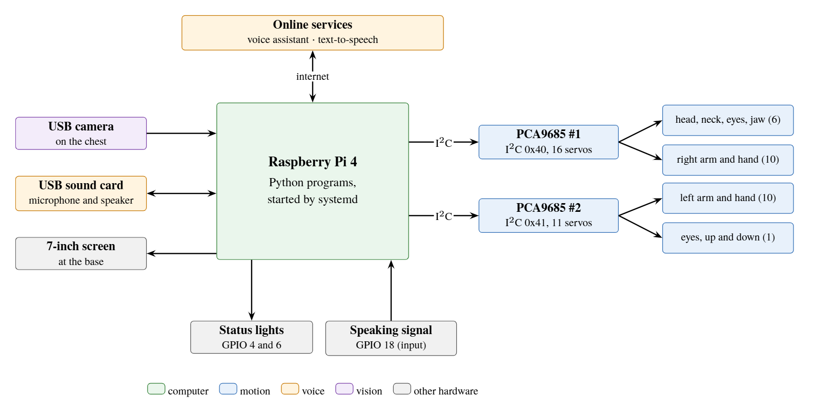 | The whole robot: the Pi, the two servo boards, the camera, the sound card and the lights | [PDF](robot-niko-system-overview.pdf) · [PNG](robot-niko-system-overview.png) |
| 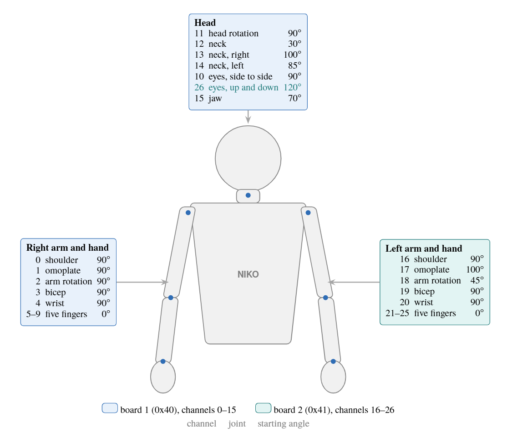 | Every servo's channel, joint and starting angle, on a front view of the robot | [PDF](robot-niko-servo-map.pdf) · [PNG](robot-niko-servo-map.png) |
| 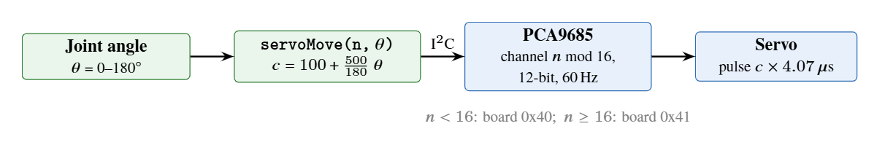 | How one call turns a joint angle into a servo pulse | [PDF](robot-niko-servo-chain.pdf) · [PNG](robot-niko-servo-chain.png) |
| 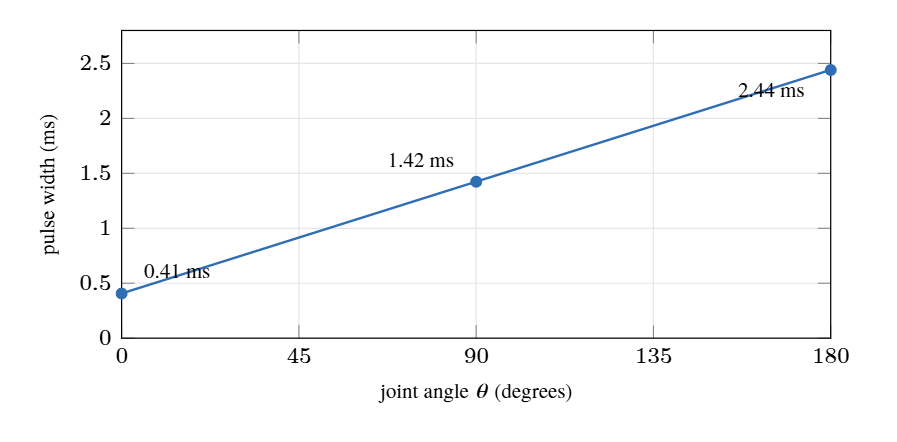 | Pulse width against joint angle, from the code's mapping | [PDF](robot-niko-angle-to-pulse.pdf) · [PNG](robot-niko-angle-to-pulse.png) |
| 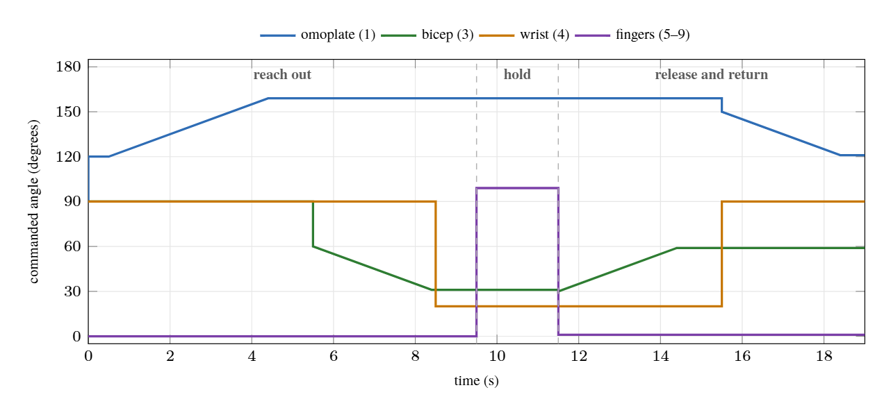 | The handshake: each joint's angle over time | [PDF](robot-niko-handshake.pdf) · [PNG](robot-niko-handshake.png) |
| 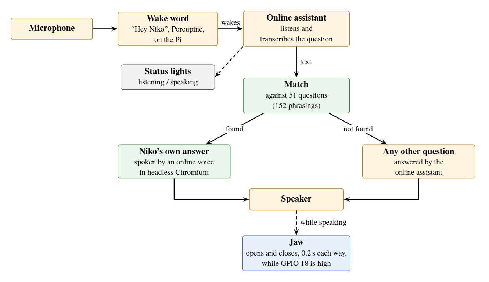 | One spoken exchange, from the wake word to the answer and the jaw | [PDF](robot-niko-voice-pipeline.pdf) · [PNG](robot-niko-voice-pipeline.png) |
| 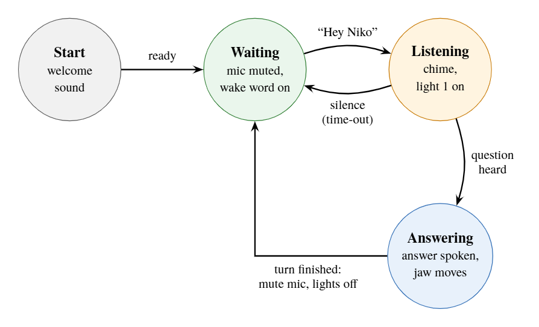 | The conversation loop: waiting, listening, answering | [PDF](robot-niko-conversation-states.pdf) · [PNG](robot-niko-conversation-states.png) |
| 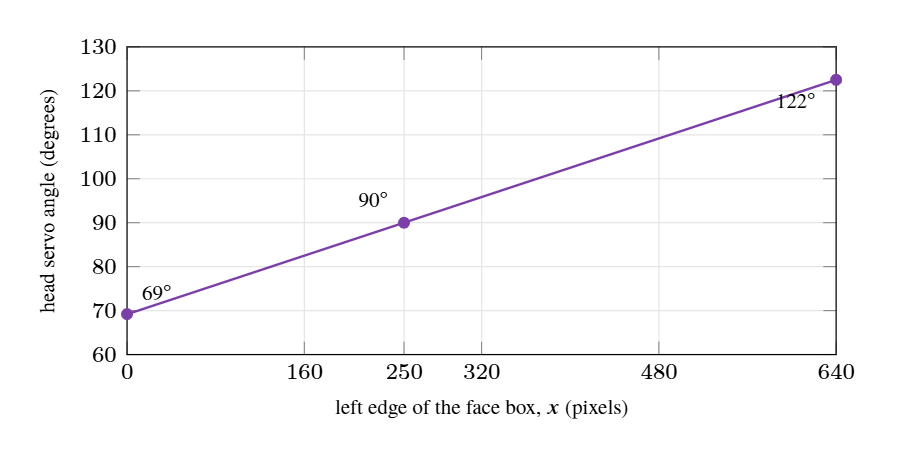 | The head-turn rule for following a face | [PDF](robot-niko-follow-face.pdf) · [PNG](robot-niko-follow-face.png) |
| 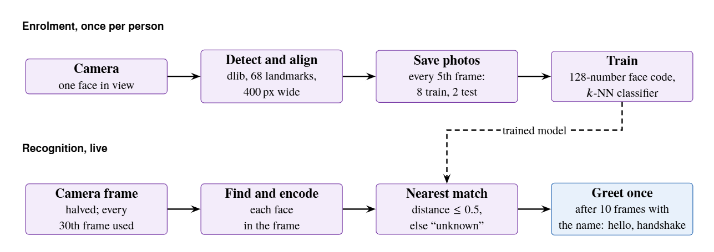 | Face enrolment, training, recognition and the greeting | [PDF](robot-niko-face-recognition.pdf) · [PNG](robot-niko-face-recognition.png) |
| 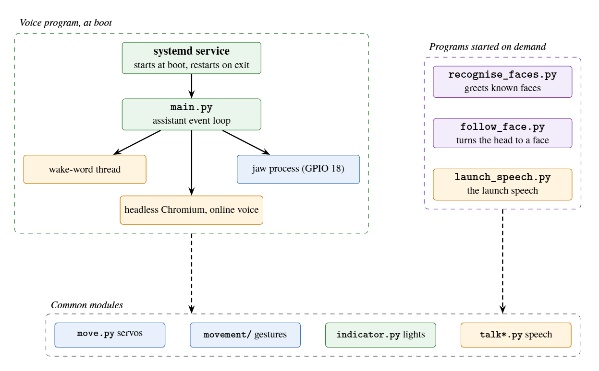 | The programs, processes and shared modules | [PDF](robot-niko-software-map.pdf) · [PNG](robot-niko-software-map.png) |
| 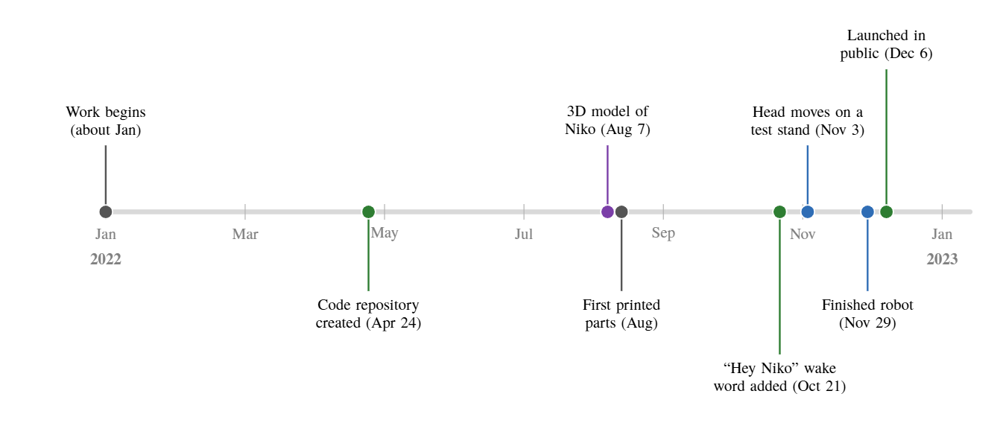 | The build in 2022, from the first work to the launch | [PDF](robot-niko-timeline.pdf) · [PNG](robot-niko-timeline.png) |
| 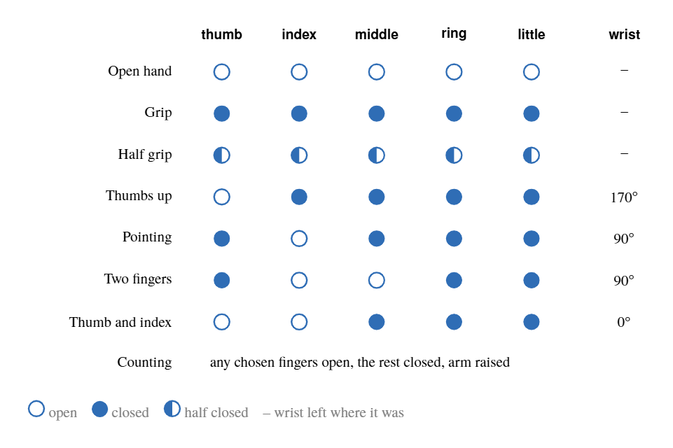 | The hand poses in the gesture library | [PDF](robot-niko-hand-gestures.pdf) · [PNG](robot-niko-hand-gestures.png) |
| 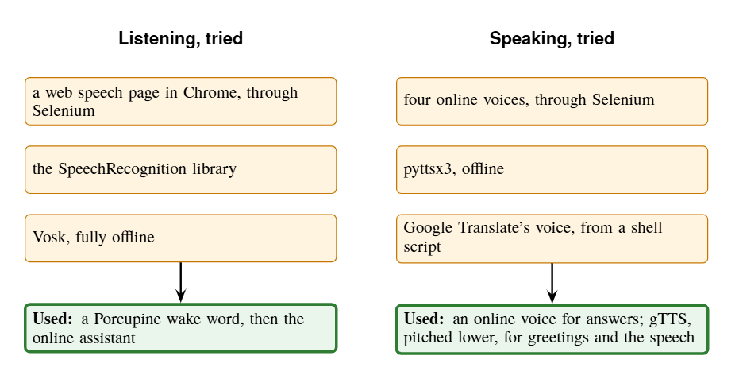 | The ways to listen and speak tried in 2022, and the ones used | [PDF](robot-niko-voice-experiments.pdf) · [PNG](robot-niko-voice-experiments.png) |

To rebuild them, run `python make-diagrams.py` in [`../report/`](../report/).
